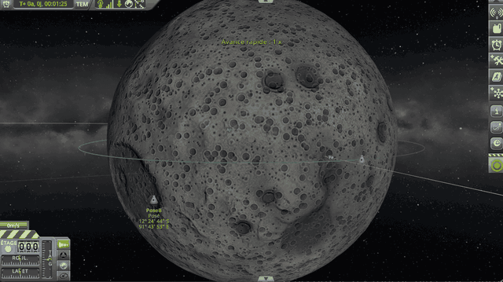

# Map Icon Circling Fix

**⚠️ Not finished yet.** This is a new fix, not a finished mod. The code and the conclusions on this page can still change.

A fix for stock KSP 1.12, kept as small as possible: one event handler, in one source file, no Harmony. It is a mod of
its own, built on top of [KSP Community Fixes](https://github.com/KSPModdingLibs/KSPCommunityFixes), the base most
players run. Here is what it fixes:

> **In time warp, the map icon of a landed vessel circles around its place.** Fly or orbit with one vessel, open the
> map view centred on the body where another vessel is landed, and warp fast: the icon of the landed vessel leaves its
> place and turns around it. The faster the warp, the wider the circle.



*KSP 1.12 with KSP Community Fixes, without this mod: a capsule in a 30 km orbit of the Mun, the active vessel, and
another one, PoseB, landed on it; the map view centred on the Mun, the time warp raised step by step from 1× to
10,000×, then lowered to 1,000×.*

After each long jump of the floating origin, the game recomputes the position of a landed vessel from a point it has
not moved: see [The culprit](#the-culprit). This mod moves that point first.

**How this was made.** The investigation and the code were written with Claude, Anthropic's AI
assistant. Everything here was reviewed and validated by a human — me. I am saying so up front, because
contributions made with an AI deserve a closer look than others, and because some people would rather
stop reading here. That look should be quick: the stock code involved is named and quoted on this page, and the fix
is one short method, in one source file you can read in a few minutes.

## Why it matters

Bases and landers left on the surface are what the map view shows when you plan the next flight to them: a rendezvous
with a landed vessel starts by watching where it is while the active vessel orbits. In time warp, that is exactly when
its icon is wrong, and the faster the warp, the further off it is.

The icon is not the only thing that moves: it is drawn at the vessel's centre of mass, `Vessel.CoMD`, which is wrong
too. Anything that reads the position of a landed vessel that is not loaded, during a high time warp, reads the same
wrong place. The vessel itself is not moved: the game puts it back at its latitude and longitude at the next physics
step, and loads it where it belongs.

## The culprit

KSP keeps the active vessel near the origin of the Unity world by shifting everything when it gets too far:
`FloatingOrigin.setOffset`. In high time warp, with the active vessel flying or in orbit, it does so at every physics
step, by the distance the active vessel covered during that step.

`setOffset` moves every vessel by the shift. For a shift longer than 10 km (`CoMRecalcOffsetMaxSqr`, 10⁸ m²), it then
recomputes the centre of mass of every packed vessel instead of moving it:

```csharp
// FloatingOrigin.setOffset (KSP 1.12)
vessel.SetPosition((Vector3d)vessel.transform.position - shift);
if (offset.sqrMagnitude > CoMRecalcOffsetMaxSqr && vessel.packed)
{
    vessel.precalc.CalculatePhysicsStats();
}
else
{
    vessel.CoMD -= shift;
    vessel.CoM = vessel.CoMD;
}
```

For a landed vessel that is not loaded, `VesselPrecalculate.CalculatePhysicsStats` does not start from the vessel's
transform, which was just moved, but from the surface position `VesselPrecalculate.SetLandedPosRot` stored before the
shift:

```csharp
// VesselPrecalculate.CalculatePhysicsStats (KSP 1.12), a packed vessel without rigidbodies
if (vessel.LandedOrSplashed)
{
    vessel.CoMD = worldSurfacePos + worldSurfaceRot * vessel.localCoM;
}
```

`worldSurfacePos` is not shifted: `CoMD` stays where it was before the shift, off by the whole shift. The next physics
step computes `worldSurfacePos` again from latitude and longitude, and `CoMD` is right again, until the floating origin
shifts once more in the same step. Every rendered frame sees the wrong `CoMD`, and the map icon, placed at
`Vessel.GetWorldPos3D()`, that is `CoMD`, with it.

The error has the length of the shift, in the direction the active vessel moves. As the active vessel goes around its
orbit, that direction turns: the icon circles around its real place, once per orbit of the active vessel as seen from
the surface of the body. It only shows with the map centred on the body: centred on the active vessel, the whole view
turns with it, and the circle is lost in that motion.

KSP Community Fixes replaces `setOffset` with a faster copy, `FloatingOriginPerf`, that keeps the same logic.

## Checking the culprit

KSP 1.12.5 with [KSP Community Fixes](https://github.com/KSPModdingLibs/KSPCommunityFixes) 1.41.1. Copy
[map-icon-circling.sfs](diag/map-icon-circling.sfs) into the folder of a sandbox game and load it. Two capsules are
at the Mun:

- **OrbitA**, the active vessel, in a 30 km orbit;
- **PoseB**, landed on the Mun, far from OrbitA: too far to be loaded.

Then, by hand:

1. Open the map view (**M**) and double-click the Mun, to centre the map on it. Zoom in until the Mun fills most of
   the screen, the icon of PoseB on its face.
2. Raise the time warp step by step (**.**), up to 10,000×, watching the icon of PoseB.

- **Without this mod:** up to 100×, the icon stays at its place. From 1,000×, it leaves it and circles around it; at
  10,000×, the circle is so wide that the icon goes past the edge of the Mun (see the capture at the top of this
  page).
- **With this mod:** the icon stays at its place, whatever the warp.

<!-- A capture with this mod, side by side with the stock one, to record. -->

**By script.** [run-circling.py](diag/automation/run-circling.py) plays the same steps through
[KSP-Util-MCPServer](https://github.com/lhervier/KSP-Util-MCPServer), and reads what the player sees: where the icon
of PoseB is drawn, and where the latitude, longitude and altitude its caption shows lie on the Mun as the map draws
it, at the end of each of 300 rendered frames, at 1×, 100×, 1,000× and 10,000×. Python 3 only, nothing to install:
start KSP with KSP-Util-MCPServer, copy [map-icon-circling.sfs](diag/map-icon-circling.sfs) into a sandbox game,
then run:

```
python run-circling.py --folder <your sandbox game> --out out
```

It takes about twenty seconds, takes a screenshot at each rate, and prints a list of checks, each PASS or FAIL, then
exits with 0 when all pass, 1 otherwise. The checks marked (fix) are what this mod promises: they fail without it.
In a 1280 × 720 window, without this mod:

```
PASS PoseB is landed and not loaded
PASS at 1x, the icon of PoseB stays at its place (0 px at most)
PASS at 100x, the icon of PoseB stays at its place (0 px at most)
FAIL (fix) at 1000x, the icon of PoseB stays at its place (11.8 px at most)
FAIL (fix) at 10000x, the icon of PoseB stays at its place (169.3 px at most)
3 of 5 checks passed
```

With it:

```
PASS PoseB is landed and not loaded
PASS at 1x, the icon of PoseB stays at its place (0 px at most)
PASS at 100x, the icon of PoseB stays at its place (0 px at most)
PASS (fix) at 1000x, the icon of PoseB stays at its place (0 px at most)
PASS (fix) at 10000x, the icon of PoseB stays at its place (0 px at most)
5 of 5 checks passed
```

## The fix

One event handler, with its switch in [Settings](#settings), on by default. Nothing is saved; removing the mod gives
the stock behaviour back at once.

- **`fixLandedCoMAfterShift`.** In flight, the mod listens to `GameEvents.onFloatingOriginShift`, which the stock
  `setOffset` and the one of KSP Community Fixes both fire last. For a shift longer than `CoMRecalcOffsetMaxSqr`, it
  moves `worldSurfacePos` of each landed vessel that is packed and not loaded by the shift the vessel itself was moved
  by, then calls `CalculatePhysicsStats` again: `CoMD` is computed with the same formula as the game, from the right
  point.

A loaded vessel is left alone: its centre of mass comes from its rigidbodies, which were moved. Below 10 km, `setOffset`
moves `CoMD` itself, which is right. The cost is one loop over the vessels, only on a shift longer than 10 km.

## Work in progress

What a player would see if this mod broke something, or what it should fix but was not checked yet, and how to try
it by hand, with the mod and without:

- **Switching to the landed vessel after a high time warp**: with the mod, it should load at its place and stay
  still, as on stock.
- **Flying the active vessel down to the landed one after a high time warp**: same, when it loads.
- **The map centred on the landed vessel itself**: on stock, the body should circle instead of the icon; with the
  mod, nothing should move.
- **Planet packs with faster orbits** (Real Solar System): the shift reaches 10 km at a lower warp rate; the mod
  should behave the same.

## Install

Copy the `GameData\KSPFixMapIconCircling` folder into the `GameData` folder of KSP. It needs nothing else.

## Settings

`GameData\KSPFixMapIconCircling\PluginData\settings.cfg` is read once, when KSP starts:

```
// Keeps the centre of mass of an unloaded landed vessel, hence its icon in the map view, at its place after a
// floating origin shift longer than 10 km.
fixLandedCoMAfterShift = True

// How much the mod writes to KSP.log: Error, Warning, Info or Debug.
logLevel = Info
```

- With `fixLandedCoMAfterShift = False`, the mod does nothing: landed vessels keep the stock behaviour.
- At `Debug`, the mod writes one line every 1000 corrections, with the vessel and the length of the shift.

## Build

Set `KSPDIR` to the folder of a KSP install, then run `build.bat`: it compiles
`GameData\KSPFixMapIconCircling\KSPFixMapIconCircling.dll`. Installing is up to you.

## License

[MIT](LICENSE).
